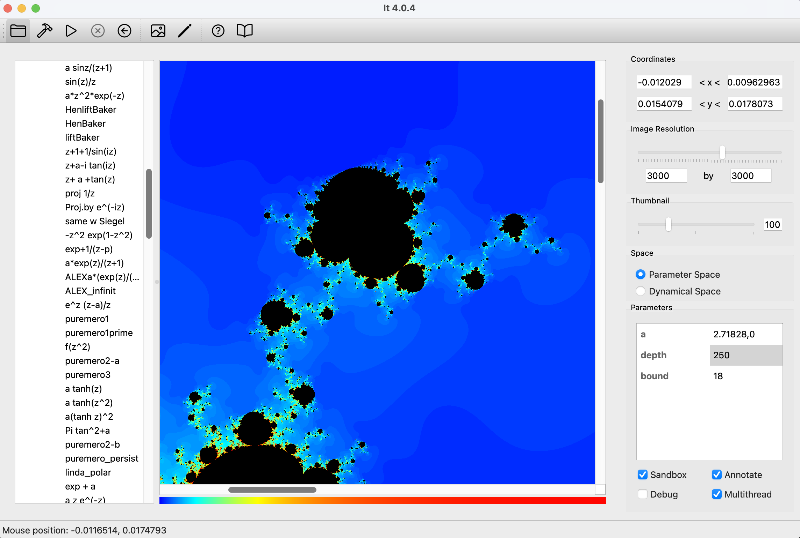

#  IT: Complex Iteration Software 

## [Holodyn Research Group](https://www.ub.edu/dynsys/holodyn/)

Funded by the Agencia Estatal de Investigación (AEI), grant PID2023-147252NB-I00, with funds from MICIU/AEI/10.13039/501100011033 y FEDER/UE.

*IT* is a desktop application for researchers in complex dynamical systems.

*IT* allows you to **visualize image generated by iteration of holomorphic functions** such as the famous Mandelbrot or Julia sets. *IT* isn’t limited to a collection of families, however. *IT* lets you **explore your own functions** by **writing code** (C++) right inside the application. Your code is compiled on the fly and lets you visualize the dynamical or parameter plane of any family of functions. You can program your own algorithms (escape time, or any other), and use a variety of palettes or create your own (discrete or continuous). 

Images can be scaled and zoomed into. Parameters - declared in your code - can be manipulated through the application’s interface. Once your image is ready, it can be exported to a number of formats: PNG, PDF, and SVG.
Image generation is fast because code is compiled, not interpreted. Furthermore, It can take advantage of **multi-core** machines to further accelerate calculations.

You can have a quick look at some of the possibilities of It in the screenshots section.

A [**manual**](doc/manual.md) is provided explaining how to code your own functions.

*It* works on MacOS, Linux, and Windows. The latest releases are found at https://github.com/holodyn-group/it/releases/latest/. You can find **[installation instructions here.](doc/download.md)**

*It* can be used free of charge under the MIT license. Should you require support, please contact the maintainer.

Created by Christian Mannes

Copyright @2012-2026 [Holodyn Group](https://www.ub.edu/dynsys/holodyn/)

